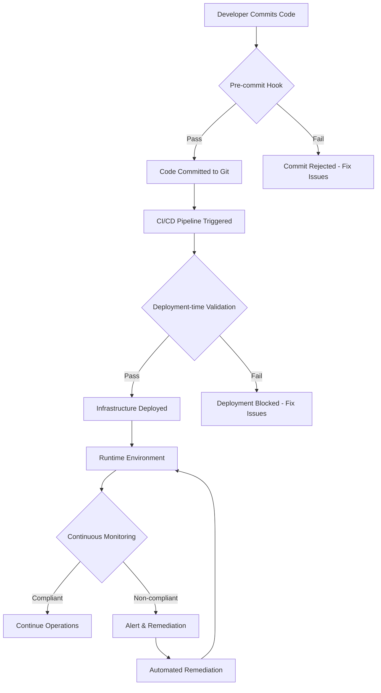

> [!WARNING]
> **STALE — flagged by the handover audit (2026-08-31).** Not verified against the current
> architecture (post-CRC lab, AAP 2.7). Findings to check: none specific — unreviewed for 293 days.
> Treat specifics as unreliable until reviewed — see
> `docs/reports/HANDOVER_AUDIT_2026-08-31.md`. Remove this banner after review.

# Compliance Validation Architecture

## Three-Tier Compliance Validation Framework

This document outlines the comprehensive compliance validation architecture that provides validation at three critical points in the infrastructure lifecycle.

## 🎯 Overview

The platform provides compliance validation at three key entry points:

1. **📝 Code Commit Time** - Pre-commit validation of Infrastructure as Code
2. **🚀 Deployment Time** - Runtime validation during infrastructure provisioning  
3. **🔍 Runtime Validation** - Continuous compliance monitoring of live environments

## 📁 Directory Structure

```
compliance-validation/
├── 1-commit-time/                          # Git pre-commit validation
│   ├── hooks/                              # Git hooks for various IaC tools
│   │   ├── pre-commit-ansible              # Ansible playbook validation
│   │   ├── pre-commit-terraform            # Terraform plan validation
│   │   ├── pre-commit-cloudformation       # CloudFormation template validation
│   │   ├── pre-commit-azure-arm            # Azure ARM template validation
│   │   └── pre-commit-gcp-deployment       # GCP Deployment Manager validation
│   ├── policies/                           # Static analysis policies
│   │   ├── ansible/                        # Ansible-specific policies
│   │   ├── terraform/                      # Terraform-specific policies
│   │   ├── cloudformation/                 # CloudFormation-specific policies
│   │   ├── azure-arm/                      # Azure ARM-specific policies
│   │   └── gcp-deployment/                 # GCP-specific policies
│   ├── validators/                         # Validation scripts
│   │   ├── ansible_validator.py            # Ansible playbook compliance checker
│   │   ├── terraform_validator.py          # Terraform plan compliance checker
│   │   ├── cloudformation_validator.py     # CloudFormation compliance checker
│   │   ├── azure_validator.py              # Azure ARM compliance checker
│   │   └── gcp_validator.py                # GCP deployment compliance checker
│   └── config/                             # Validation configuration
│       ├── compliance_rules.yaml           # Framework-specific rules
│       └── validation_config.yaml          # Validation behavior configuration
├── 2-deployment-time/                      # Deployment-time validation
│   ├── opa-sidecar/                        # OPA sidecar for runtime validation
│   │   ├── dockerfile                      # OPA sidecar container
│   │   ├── entrypoint.sh                   # Sidecar initialization
│   │   └── config.yaml                     # OPA sidecar configuration
│   ├── terraform-provider/                 # Custom Terraform provider
│   │   ├── provider.go                     # OPA Terraform provider
│   │   ├── resource_compliance_check.go    # Compliance check resource
│   │   └── data_source_policy_eval.go      # Policy evaluation data source
│   ├── ansible-callback/                   # Ansible callback plugin
│   │   ├── opa_compliance.py               # OPA compliance callback
│   │   └── callback_config.yaml            # Callback configuration
│   ├── cloud-functions/                    # Cloud-native validation functions
│   │   ├── aws-lambda/                     # AWS Lambda compliance validator
│   │   ├── azure-functions/                # Azure Functions compliance validator
│   │   └── gcp-cloud-functions/            # GCP Cloud Functions compliance validator
│   └── admission-controllers/              # Kubernetes admission controllers
│       ├── opa-gatekeeper/                 # OPA Gatekeeper integration
│       └── custom-controllers/             # Custom admission controllers
├── 3-runtime-validation/                   # Runtime environment validation
│   ├── agents/                             # Compliance monitoring agents
│   │   ├── daemon/                         # System daemon for continuous monitoring
│   │   ├── kubernetes/                     # Kubernetes compliance operator
│   │   ├── cloud-native/                   # Cloud-native monitoring solutions
│   │   └── agentless/                      # Agentless scanning solutions
│   ├── schedulers/                         # Scheduled compliance checks
│   │   ├── cron-jobs/                      # Traditional cron-based scheduling
│   │   ├── kubernetes-cronjobs/            # Kubernetes CronJob manifests
│   │   └── cloud-schedulers/               # Cloud-native scheduling
│   ├── event-driven/                       # Event-driven compliance validation
│   │   ├── webhook-handlers/               # Webhook-based validation
│   │   ├── message-queue/                  # Message queue-based validation
│   │   └── stream-processing/              # Real-time stream processing
│   └── reporting/                          # Runtime compliance reporting
│       ├── dashboards/                     # Real-time compliance dashboards
│       ├── alerting/                       # Compliance violation alerting
│       └── audit-trails/                   # Compliance audit trail management
├── orchestrator/                           # Unified compliance orchestration
│   ├── api/                                # REST API for compliance validation
│   ├── cli/                                # Command-line interface
│   ├── web-ui/                             # Web-based compliance dashboard
│   └── integrations/                       # Third-party tool integrations
├── policies/                               # Shared policy libraries
│   ├── fisma/                              # FISMA policies for all entry points
│   ├── nerc-cip/                           # NERC-CIP policies for all entry points
│   ├── soc2/                               # SOC 2 policies for all entry points
│   ├── pci-dss/                            # PCI-DSS policies for all entry points
│   ├── iso27001/                           # ISO 27001 policies for all entry points
│   └── cis/                                # CIS benchmark policies for all entry points
├── examples/                               # Example configurations and integrations
│   ├── gitops-workflows/                   # GitOps workflow examples
│   ├── cicd-pipelines/                     # CI/CD pipeline integrations
│   └── infrastructure-templates/           # IaC template examples
├── tests/                                  # Comprehensive testing suite
│   ├── commit-time-tests/                  # Pre-commit validation tests
│   ├── deployment-time-tests/              # Deployment validation tests
│   └── runtime-tests/                      # Runtime validation tests
└── docs/                                   # Comprehensive documentation
    ├── integration-guides/                 # Tool-specific integration guides
    ├── deployment-patterns/                # Common deployment patterns
    └── troubleshooting/                    # Troubleshooting guides
```

## 🔄 Validation Flow Overview



## Entry Point Details

### 1. 📝 Commit-Time Validation
**Purpose**: Prevent non-compliant Infrastructure as Code from entering the repository

**Scope**: 
- Ansible playbooks and roles
- Terraform plans and modules
- CloudFormation templates
- Azure ARM templates
- GCP Deployment Manager templates
- Kubernetes manifests

**Implementation**: Git pre-commit hooks with OPA policy evaluation

### 2. 🚀 Deployment-Time Validation  
**Purpose**: Validate compliance during actual infrastructure provisioning

**Scope**:
- Resource creation validation
- Configuration drift detection
- Deployment approval gates
- Real-time policy enforcement

**Implementation**: Custom providers, callback plugins, admission controllers

### 3. 🔍 Runtime Validation
**Purpose**: Continuous compliance monitoring of live infrastructure

**Scope**:
- Running systems and services
- Configuration drift detection
- Security posture assessment
- Compliance reporting and alerting

**Implementation**: Agents, schedulers, event-driven validation