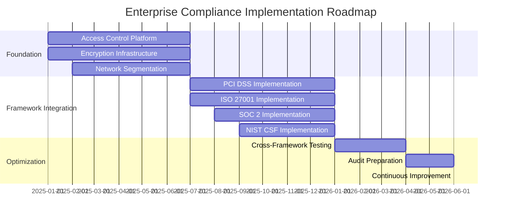

> [!WARNING]
> **STALE — flagged by the handover audit (2026-08-31).** Not verified against the current
> architecture (post-CRC lab, AAP 2.7). Findings to check: none specific — unreviewed for 293 days.
> Treat specifics as unreliable until reviewed — see
> `docs/reports/HANDOVER_AUDIT_2026-08-31.md`. Remove this banner after review.

# Regulatory Framework Mapping and Cross-Compliance Analysis

**Authors:** Tim Coulter & Claude
**Date:** October 15, 2025

## Comprehensive Framework Alignment for Enterprise Organizations

### Executive Summary

This document provides a detailed mapping and analysis of relationships between major compliance frameworks, enabling organizations to optimize their compliance investments through shared controls and unified implementation strategies.

---

## 🗺️ Framework Relationship Matrix

### Primary Framework Categories

#### **Financial Services & Payment Processing**
- **PCI DSS**: Payment Card Industry Data Security Standard
- **SOX**: Sarbanes-Oxley Act
- **GLBA**: Gramm-Leach-Bliley Act
- **FFIEC**: Federal Financial Institutions Examination Council

#### **Information Security & Risk Management**
- **ISO 27001**: Information Security Management Systems
- **NIST CSF**: National Institute of Standards and Technology Cybersecurity Framework
- **CIS Controls**: Center for Internet Security Critical Security Controls
- **COBIT**: Control Objectives for Information and Related Technologies

#### **Privacy & Data Protection**
- **GDPR**: General Data Protection Regulation
- **CCPA**: California Consumer Privacy Act
- **PIPEDA**: Personal Information Protection and Electronic Documents Act
- **HIPAA**: Health Insurance Portability and Accountability Act

#### **Service Organization & Trust**
- **SOC 2**: Service Organization Control 2
- **SOC 1**: Service Organization Control 1
- **FedRAMP**: Federal Risk and Authorization Management Program
- **CSA CCM**: Cloud Security Alliance Cloud Controls Matrix

---

## 📊 Control Overlap Analysis

### High-Overlap Control Areas (80%+ Framework Coverage)

#### **Access Control & Identity Management**
```yaml
control_area: "Access Control"
frameworks_covered:
  - pci_dss: ["Requirement 7", "Requirement 8"]
  - iso27001: ["A.9.1", "A.9.2", "A.9.4"]
  - soc2: ["CC6.1", "CC6.2", "CC6.3"]
  - nist_csf: ["PR.AC-1", "PR.AC-4", "PR.AC-6"]
  - cis: ["Control 4", "Control 5", "Control 6"]
  - gdpr: ["Article 32(1)(b)"]
overlap_percentage: 95
implementation_priority: "CRITICAL"
shared_requirements:
  - unique_user_identification
  - strong_authentication
  - access_authorization
  - account_management
  - privilege_escalation_controls
```

#### **Encryption & Cryptographic Controls**
```yaml
control_area: "Encryption"
frameworks_covered:
  - pci_dss: ["Requirement 3", "Requirement 4"]
  - iso27001: ["A.10.1", "A.13.1"]
  - soc2: ["CC6.1", "A1.2"]
  - nist_csf: ["PR.DS-1", "PR.DS-2"]
  - cis: ["Control 3"]
  - gdpr: ["Article 32(1)(a)", "Article 34(3)(a)"]
overlap_percentage: 92
implementation_priority: "CRITICAL"
shared_requirements:
  - data_encryption_at_rest
  - data_encryption_in_transit
  - key_management
  - cryptographic_standards_compliance
```

#### **Network Security & Segmentation**
```yaml
control_area: "Network Security"
frameworks_covered:
  - pci_dss: ["Requirement 1", "Requirement 2"]
  - iso27001: ["A.13.1", "A.13.2"]
  - soc2: ["CC6.1", "CC7.2"]
  - nist_csf: ["PR.AC-4", "PR.AC-5"]
  - cis: ["Control 9", "Control 11", "Control 12"]
overlap_percentage: 88
implementation_priority: "HIGH"
shared_requirements:
  - network_segmentation
  - firewall_configuration
  - secure_network_architecture
  - network_monitoring
```

### Medium-Overlap Control Areas (50-79% Framework Coverage)

#### **Vulnerability Management**
```yaml
control_area: "Vulnerability Management"
frameworks_covered:
  - pci_dss: ["Requirement 6", "Requirement 11"]
  - iso27001: ["A.12.6", "A.14.2"]
  - soc2: ["CC7.1"]
  - nist_csf: ["ID.RA-1", "DE.CM-8"]
  - cis: ["Control 7"]
overlap_percentage: 75
implementation_priority: "HIGH"
shared_requirements:
  - vulnerability_scanning
  - patch_management
  - secure_development
  - penetration_testing
```

#### **Incident Response & Management**
```yaml
control_area: "Incident Response"
frameworks_covered:
  - pci_dss: ["Requirement 12.10"]
  - iso27001: ["A.16.1"]
  - soc2: ["CC7.4", "A1.3"]
  - nist_csf: ["RS.RP-1", "RS.CO-1", "RS.AN-1"]
  - gdpr: ["Article 33", "Article 34"]
overlap_percentage: 70
implementation_priority: "MEDIUM"
shared_requirements:
  - incident_response_plan
  - incident_detection
  - incident_notification
  - forensic_capabilities
```

#### **Risk Assessment & Management**
```yaml
control_area: "Risk Management"
frameworks_covered:
  - pci_dss: ["Requirement 12.2"]
  - iso27001: ["A.6.1.1", "A.6.1.2"]
  - soc2: ["CC3.1", "CC3.2"]
  - nist_csf: ["ID.GV-1", "ID.RM-1"]
overlap_percentage: 65
implementation_priority: "MEDIUM"
shared_requirements:
  - risk_assessment_process
  - risk_treatment_planning
  - risk_monitoring
  - business_impact_analysis
```

### Low-Overlap Control Areas (25-49% Framework Coverage)

#### **Data Classification & Handling**
```yaml
control_area: "Data Classification"
frameworks_covered:
  - pci_dss: ["Requirement 3.1"]
  - iso27001: ["A.8.2"]
  - gdpr: ["Article 5", "Article 6"]
overlap_percentage: 45
implementation_priority: "MEDIUM"
framework_specific_requirements:
  pci_dss: "Cardholder data specific"
  gdpr: "Personal data specific"
  iso27001: "All information assets"
```

#### **Training & Awareness**
```yaml
control_area: "Security Awareness"
frameworks_covered:
  - pci_dss: ["Requirement 12.6"]
  - iso27001: ["A.7.2.2"]
  - soc2: ["CC2.3"]
overlap_percentage: 40
implementation_priority: "LOW"
shared_requirements:
  - security_awareness_program
  - role_specific_training
  - training_effectiveness_measurement
```

---

## 🔄 Framework Mapping Tables

### PCI DSS to Other Frameworks

| PCI DSS Requirement | ISO 27001 | SOC 2 | NIST CSF | CIS Controls |
|---------------------|-----------|--------|----------|--------------|
| **Req 1: Firewall** | A.13.1.1, A.13.2.1 | CC6.1 | PR.AC-4, PR.AC-5 | 9, 11, 12 |
| **Req 2: Defaults** | A.12.6.1, A.14.2.5 | CC7.1 | PR.IP-1, PR.PT-3 | 2, 3, 5 |
| **Req 3: Protect Data** | A.10.1.1, A.10.1.2 | CC6.1, A1.2 | PR.DS-1, PR.DS-2 | 3, 13 |
| **Req 4: Encrypt Transmission** | A.13.1.1, A.13.2.1 | CC6.1 | PR.DS-2, PR.PT-4 | 3, 13 |
| **Req 5: Anti-Malware** | A.12.2.1 | CC7.2 | DE.CM-4, PR.PT-1 | 8, 10 |
| **Req 6: Secure Systems** | A.14.2.1, A.14.2.8 | CC7.1, CC8.1 | PR.IP-1, PR.PT-2 | 2, 7, 18 |
| **Req 7: Access by Need** | A.9.1.2, A.9.2.3 | CC6.2, CC6.3 | PR.AC-4, PR.PT-3 | 4, 5, 14 |
| **Req 8: Assign Unique ID** | A.9.2.1, A.9.2.2 | CC6.1, CC6.2 | PR.AC-1, PR.AC-6 | 4, 5, 16 |
| **Req 9: Physical Access** | A.11.1.1, A.11.2.1 | CC6.4, CC6.5 | PR.AC-2, PR.PT-2 | 1 |
| **Req 10: Track Access** | A.12.4.1, A.12.4.2 | CC7.2, A1.2 | DE.AE-3, PR.PT-1 | 6, 8 |
| **Req 11: Test Security** | A.12.6.1, A.14.2.3 | CC7.1 | DE.CM-8, PR.IP-2 | 7, 20 |
| **Req 12: Policy** | A.5.1.1, A.5.1.2 | CC2.1, CC2.2 | ID.GV-1, PR.IP-1 | 1, 2, 17 |

### ISO 27001 to SOC 2 Trust Services

| ISO 27001 Control | SOC 2 Security | SOC 2 Availability | SOC 2 Confidentiality | SOC 2 Processing Integrity |
|-------------------|----------------|--------------------|-----------------------|----------------------------|
| **A.5.1 - Policies** | CC2.1, CC2.2 | A1.1 | C1.1 | PI1.1 |
| **A.9.1 - Access Control** | CC6.1, CC6.2 | A1.2 | C1.2 | PI1.3 |
| **A.10.1 - Cryptography** | CC6.1 | A1.2 | C1.1 | PI1.2 |
| **A.12.1 - Operations** | CC7.1, CC7.2 | A1.1, A1.2 | C1.2 | PI1.1 |
| **A.12.6 - Vulnerability** | CC7.1 | A1.2 | - | PI1.3 |
| **A.13.1 - Network Security** | CC6.1, CC7.2 | A1.2 | C1.2 | - |
| **A.16.1 - Incident Management** | CC7.4 | A1.3 | C1.2 | PI1.3 |

### NIST CSF to CIS Controls

| NIST CSF Function | NIST CSF Category | Primary CIS Controls | Secondary CIS Controls |
|-------------------|-------------------|---------------------|----------------------|
| **IDENTIFY** | Asset Management (ID.AM) | 1, 2 | 12, 13 |
| **IDENTIFY** | Governance (ID.GV) | 1 | 2, 17 |
| **IDENTIFY** | Risk Assessment (ID.RA) | 1, 2 | 7, 20 |
| **PROTECT** | Access Control (PR.AC) | 4, 5, 6 | 14, 16 |
| **PROTECT** | Data Security (PR.DS) | 3, 13 | 14 |
| **PROTECT** | Protective Technology (PR.PT) | 2, 3, 7 | 8, 10 |
| **DETECT** | Anomalies/Events (DE.AE) | 6, 8 | 12, 15 |
| **DETECT** | Continuous Monitoring (DE.CM) | 6, 7, 8 | 11, 20 |
| **RESPOND** | Response Planning (RS.RP) | 17, 19 | 1 |
| **RESPOND** | Analysis (RS.AN) | 6, 8 | 17, 19 |
| **RECOVER** | Recovery Planning (RC.RP) | 11 | 1, 17 |

---

## 💼 Enterprise Implementation Strategy

### Phase 1: Foundation Controls (Months 1-6)

#### **Priority 1: High-Overlap Critical Controls**
- **Access Control & Identity Management**
  - Unified identity provider implementation
  - Role-based access control (RBAC) system
  - Multi-factor authentication (MFA) deployment
  - Privileged access management (PAM) solution

- **Encryption & Cryptographic Controls**
  - Enterprise key management system
  - Data encryption at rest and in transit
  - Cryptographic policy implementation
  - Key lifecycle management procedures

- **Network Security & Segmentation**
  - Network architecture redesign
  - Micro-segmentation implementation
  - Firewall rule standardization
  - Network monitoring deployment

#### **Business Value**: 60-70% compliance coverage across all frameworks

### Phase 2: Framework-Specific Controls (Months 7-12)

#### **Priority 2: Medium-Overlap Controls**
- **Vulnerability Management**
  - Centralized vulnerability scanning
  - Automated patch management
  - Secure development lifecycle
  - Regular penetration testing

- **Incident Response & Management**
  - Unified incident response platform
  - Security operations center (SOC) enhancement
  - Automated incident workflows
  - Cross-framework incident reporting

#### **Business Value**: 85-90% compliance coverage across all frameworks

### Phase 3: Optimization & Specialization (Months 13-18)

#### **Priority 3: Framework-Specific Requirements**
- **PCI DSS Specialization**
  - Cardholder data environment (CDE) isolation
  - Payment processing security controls
  - QSA assessment preparation

- **GDPR Specialization**
  - Data subject rights implementation
  - Privacy impact assessments
  - Data protection officer functions

- **SOC 2 Specialization**
  - Trust services criteria mapping
  - Control evidence collection
  - Third-party auditor coordination

#### **Business Value**: 95%+ compliance coverage with audit readiness

---

### Implementation Timeline and Milestones



---

## 🎯 Framework-Specific Guidance

### When to Prioritize Each Framework

#### **PCI DSS - Immediate Priority If:**
- Processing, storing, or transmitting cardholder data
- Required for payment processing partnerships
- Customer contracts mandate PCI compliance
- Geographic presence in regions with strict payment regulations

#### **SOC 2 - Immediate Priority If:**
- Providing services to enterprise customers
- Cloud-based or SaaS business model
- Customer contracts require SOC 2 Type II reports
- Seeking enterprise market expansion

#### **ISO 27001 - Consider Priority If:**
- International business operations
- Government or defense sector customers
- Seeking competitive differentiation
- Regulatory requirements in target markets

#### **NIST CSF - Baseline Foundation If:**
- U.S.-based operations
- Government sector engagement
- Seeking comprehensive cybersecurity framework
- Industry peer pressure or best practices adoption

#### **GDPR - Legal Requirement If:**
- EU residents' personal data processing
- EU market presence or customers
- Cross-border data transfers to EU
- Digital services targeting EU users

---

## 🔍 Gap Analysis Template

### Framework Readiness Assessment

```yaml
framework_assessment:
  organization: "COMPANY_NAME"
  assessment_date: "YYYY-MM-DD"
  assessor: "ASSESSMENT_TEAM"
  
  current_state:
    pci_dss:
      compliance_level: "NOT_ASSESSED | PARTIAL | COMPLIANT"
      last_assessment: "YYYY-MM-DD"
      gaps_identified: []
      remediation_timeline: "X_MONTHS"
      
    iso27001:
      compliance_level: "NOT_ASSESSED | PARTIAL | COMPLIANT"
      certification_status: "NONE | IN_PROGRESS | CERTIFIED"
      gaps_identified: []
      remediation_timeline: "X_MONTHS"
      
    soc2:
      compliance_level: "NOT_ASSESSED | PARTIAL | COMPLIANT"
      report_type: "NONE | TYPE_I | TYPE_II"
      gaps_identified: []
      remediation_timeline: "X_MONTHS"
      
  shared_controls_status:
    access_control:
      implementation: "NOT_STARTED | IN_PROGRESS | COMPLETE"
      frameworks_covered: []
      coverage_percentage: X
      
    encryption:
      implementation: "NOT_STARTED | IN_PROGRESS | COMPLETE"
      frameworks_covered: []
      coverage_percentage: X
      
  recommendations:
    immediate_actions: []
    phase_1_priorities: []
    phase_2_priorities: []
    phase_3_priorities: []
    
  resource_requirements:
    budget_estimate: "$X.XM"
    staffing_needs: X_FTE
    timeline_estimate: "X_MONTHS"
    external_support_needed: "YES | NO"
```

---

## 📚 Implementation Resources

### Documentation Templates
- **Cross-Framework Policy Template**: Unified policy structure covering multiple frameworks
- **Control Implementation Guides**: Step-by-step implementation for shared controls
- **Evidence Collection Matrices**: Unified evidence collection for multiple audits
- **Training Curriculum Maps**: Role-based training covering multiple frameworks

### Automation Scripts
- **Compliance Assessment Automation**: OPA policies for cross-framework evaluation
- **Evidence Collection Automation**: Automated collection for multiple frameworks
- **Reporting Automation**: Unified compliance dashboards and reports
- **Gap Analysis Automation**: Automated identification of compliance gaps

### Vendor Integration Guides
- **Identity Provider Integration**: SSO/SAML integration for multiple frameworks
- **SIEM Platform Integration**: Security monitoring for multiple frameworks
- **GRC Tool Integration**: Governance, risk, and compliance platform setup
- **Cloud Security Integration**: Multi-cloud compliance monitoring

---

This regulatory mapping framework provides the foundation for organizations to implement efficient, cost-effective compliance programs that leverage shared controls and unified processes across multiple regulatory requirements.