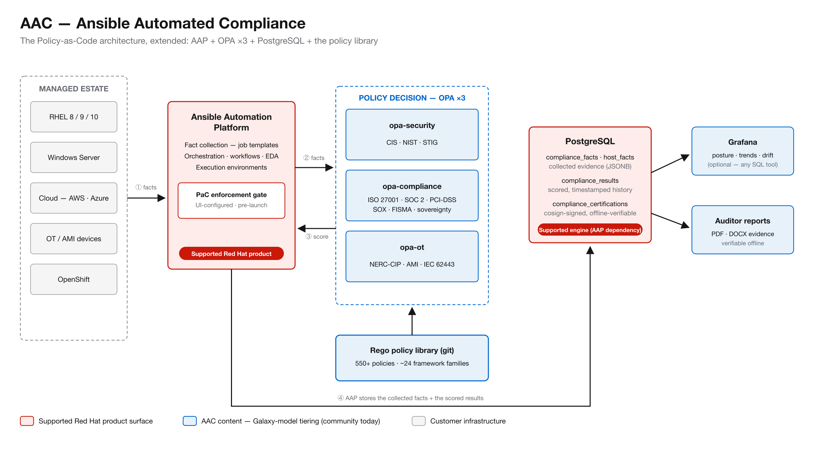

# PaC and AAC — Slide Source

**Version:** v1.5
**Date:** 2026-08-31
**Purpose:** Short slide-deck source for the support conversation. **Meeting objective: get
feedback and direction from Support — what they will currently agree to cover, and their
requirements and suggestions (documentation, code, format) for being successful on support
calls.** Each section below is one slide.
**Audience:** Support engineers and support leadership.
**Authors:** Tim Coulter; Claude (Anthropic).
**Source of detail:** [`ANSIBLE_POLICY_AS_CODE_vs_AAC.md`](ANSIBLE_POLICY_AS_CODE_vs_AAC.md) (v2.4)
— every claim here is grounded there, with live-environment evidence.

---

## Slide 1 — The one-liner

> **AAC = PaC + three OPA servers + a database + the policy library.**

- PaC keeps your automation in policy. AAC does that too — and keeps the history, the standards
  library, and the governance that prove your infrastructure is.

---

## Slide 2 — Agenda

**Objective:** get feedback and direction from Support —

- What Support will **currently agree to** cover
- Support's **requirements and suggestions** for the documentation, code, and format that set
  them up to be successful when the support calls come

**Steps:**

1. **The problems AAC solves** — why this platform exists
2. **The AAC architecture** — PaC as the supported baseline; what AAC adds (3 OPA + DB +
   policy library)
3. **What Support covers today** — the component-by-component table
4. **Discussion** — covering the rest: the Galaxy model tiers, and what Support needs from us

---

## Slide 3 — The problems AAC solves

- **Proving compliance is manual, expensive, and point-in-time.** Evidence gathering for an
  audit is screenshots, spreadsheets, and interviews — repeated every cycle. AAC makes every
  assessment a durable, scored, cosign-signed record an auditor can verify offline.
- **Every framework has its own tool.** CIS, STIG, NIST, ISO 27001, PCI-DSS, SOX, NERC-CIP,
  IEC 62443… bought and operated separately. AAC assesses 50+ frameworks through one engine,
  one policy language, one evidence store.
- **Nothing watches between audits.** Config drift and unauthorized change surface months
  later, at the next assessment. AAC baselines configurations, detects unauthorized change,
  and keeps the trend history that shows posture over time.
- **The automation itself is ungoverned.** Playbooks, Terraform plans, container images, and
  AI-driven changes reach production without policy checks. AAC gates them at git check-in, at
  runtime, and in the audit sweep — the same lane PaC opened, applied more broadly.

**All of it on the platform the customer already runs: AAP.**

---

## Slide 4 — What PaC is

- **A supported Red Hat product feature.** GA in AAP 2.5.5; documented in AAP 2.5, 2.6, and 2.7.
- **Architecture: AAP + OPA.** The controller calls an external OPA server to evaluate Rego
  policy before a job launches.
- **Configured in the UI.** OPA connection is first-class controller settings — `OPA_HOST`,
  `OPA_PORT`, TLS/auth options, `OPA_REQUEST_TIMEOUT` (1.5 s), `OPA_REQUEST_RETRIES` (2).
  Policies are associated in the UI at three points: **organization, inventory, job template**.
- **Customer brings two things:** the OPA server itself, and the Rego policies (Red Hat
  publishes 12 examples).

---

## Slide 5 — How PaC works

```
User launches job
      ▼
AAP controller builds job-context JSON  (template, user, credentials,
      ▼                                  extra_vars, inventory, EE, time)
OPA evaluates the policy                 POST /v1/data/<policy>  [1.5 s timeout]
      ▼
{ "allowed": false, "violations": ["..."] }
      ▼
allowed → job runs        not allowed → job blocked, violations shown
```

- **Synchronous gate** on the job-launch path — a decision in under 2 seconds.
- **Input is job metadata only** — PaC never sees the playbook's contents.
- **Nothing is persisted.** The decision gates the launch and is gone.

---

## Slide 6 — What AAC is

> **AAC = PAC + 3 OPA + DB.** Same engine, same language, same API — plus history and content.

- **Three OPA servers, domain-split:** `opa-security` (CIS, NIST, STIG) · `opa-compliance`
  (ISO 27001, SOC 2, PCI, SOX, FISMA, sovereignty) · `opa-ot` (NERC-CIP, AMI, IEC 62443).
  Same component PaC already requires — more instances of it.
- **OPA calls live in the playbooks.** AAP jobs collect facts from managed systems
  (~180 KB per system), then POST them to OPA: `/v1/data/<framework>/compliance_report`.
- **History lives in the database.** Every evaluation is a durable, timestamped, scored row in
  PostgreSQL (`compliance_results`), cosign-signed for offline audit verification
  (`compliance_certifications`).
- **The Rego policies come included.** 550+ curated policy files across ~two dozen framework
  families — where PaC hands you a blank page and 12 examples.

---

## Slide 7 — How AAC works

```
Managed systems (RHEL / Windows / cloud / OT / OpenShift)
      ▼  AAP job collects facts (~180 KB per system)
OPA evaluates the framework              POST /v1/data/<framework>/compliance_report
      ▼  per-control results, score, violations
PostgreSQL stores the row                → Grafana dashboards
      ▼                                  → PDF/DOCX auditor reports
cosign-signed certification record (offline-verifiable)
```

- **Asynchronous assessment**, off the launch path — seconds to minutes per framework.
- **Everything is persisted** — trends, quarter-over-quarter posture, evidence chain.

---

## Slide 8 — The AAC architecture (one picture)



**AAP is the hub.** The numbered flow: ① AAP collects facts from the estate → ② AAP POSTs them
to OPA → ③ OPA returns the score/violations to AAP → ④ AAP stores **both the collected facts
and the scored results** in PostgreSQL (`compliance_facts` / `host_facts` hold the JSONB
evidence; `compliance_results` the scored history; `compliance_certifications` the signed
records). Grafana and auditor reports read from the database. Color-coded to the support
conversation: **red = supported Red Hat product surface**, **blue = AAC content on the Galaxy
model**, **gray = customer infrastructure**. Source: `aac_architecture.svg` alongside this
document.

---

## Slide 9 — Side by side

| | **PaC** | **AAC** |
|---|---|---|
| Policy engine / language / API | OPA · Rego · v1 | OPA · Rego · v1 (same) |
| Where OPA is called from | **Controller UI settings** — pre-launch gate | **Playbooks** — post-collection assessment |
| What OPA evaluates | Job metadata | Facts collected from the estate |
| OPA servers | 1, customer-provided | 3, domain-split, deployed by AAC |
| Decision persisted? | ❌ gone after launch | ✅ PostgreSQL history, signed |
| Policy content | Customer-written (12 examples) | 550+ policy library included |
| Blocks a non-compliant job | ✅ unbypassable, platform-enforced | ✅ content-enforced (git gate + audit sweep as backstops) |
| Sees playbook contents / Terraform / K8s / CI-CD | ❌ structurally cannot | ✅ |
| Proves estate compliance to an auditor | ❌ | ✅ |

Neither absorbs the other: PaC can't run a 338-control benchmark in 1.5 s; AAC has nothing to
assess at launch time. **Architectural boundary, not a feature gap. Run both.**

---

## Slide 10 — What Support covers today

Component by component, an AAC deployment splits cleanly:

| Component | Covered today? | Basis |
|---|---|---|
| RHEL | ✅ Supported | Standard product support |
| AAP — controller, EEs, job templates, credentials | ✅ Supported | Standard product support |
| PaC enforcement feature | ✅ Supported | Product feature, GA AAP 2.5.5 |
| OPA invoked from AAP | ✅ Supported capability | The productized PaC pattern |
| PostgreSQL | ✅ As an AAP dependency | AAC's compliance DB is another instance of the same engine |
| **OPA server instances (×3)** | ❌ Customer-provided | True under PaC too — Red Hat doesn't ship the OPA server |
| **Rego policy library (550+)** | ❌ Content | Community tier today — the Galaxy model (Slide 11) |
| **Playbooks / delivery layer** | ❌ Content | Platform-team owned, like any customer's own playbooks |
| Grafana | ❌ Optional | Presentation only; replaceable by any SQL dashboard tool |

**Triage follows the same line.** Ladder: AAP healthy → job reached EE → OPA reachable →
policies loaded → framework resolves → PostgreSQL accepted → answer correct. First failing
layer owns the problem; layers 1–3 are standard Red Hat support, 4–7 are content.

---

## Slide 11 — Covering the rest: the Galaxy model

**The Rego libraries fall under the Galaxy model.** This is not a new support question — it is
the Ansible collections model, applied to Rego instead of YAML and Python:

| Tier | Where it lives | Who supports it | Where the Rego library sits |
|---|---|---|---|
| **Community** | Galaxy | Community — no entitlement | ✅ **Today.** Public, Apache-2.0, declared honestly |
| **Validated** | Automation Hub | Red Hat tested against a matrix | The next rung — curated subset, verified against benchmarks |
| **Certified** | Automation Hub | Red Hat supported, with SLAs | The bar for a support entitlement |

Red Hat ships the engine and supports it; content is a separate artifact with its own declared
tier. A customer running community content has no entitlement **and is not surprised by that**.

**What the next tier up requires** (the gap list): bounded scope · semver + signed immutable
releases · lifecycle policy · **a named owning team with a defect SLA** (the hardest item —
organizational, not technical) · CI on everything a customer runs · a tested support matrix ·
diagnostics bundle · security/CVE response process · license reconciliation.

---

## Slide 12 — Say it honestly

- The **policy layer is product-grade**: 550+ policies, 540+ tests, gated in CI.
- The **delivery layer** (playbooks a customer installs) is a reference implementation — 9
  tests, no CI. The realistic path: tier the policy library; keep the delivery layer explicitly
  out of scope, customer- or consulting-owned.
- **One caveat to size honestly:** compliance content carries a currency treadmill an ordinary
  collection doesn't — CIS reissues benchmarks, NERC adds standards. Whoever owns a tier above
  community owns that treadmill.
- The right question is not *"can AAC be supported?"* but **"which tier does this content belong
  in, and what is the bar for the next one up?"**

---

## Revision history

| Version | Date | Change |
|---|---|---|
| v1.5 | 2026-08-31 | Architecture diagram corrected per Tim: AAP is the hub — facts out to OPA, decision back to AAP, AAP writes to PostgreSQL (no OPA→DB arrow); PostgreSQL shown holding the collected facts (compliance_facts / host_facts) as well as results, per the schema. |
| v1.4 | 2026-08-31 | Added Slide 8: the AAC architecture as a single picture (aac_architecture.svg/png, color-coded: red = supported Red Hat surface, blue = AAC content, gray = customer infrastructure). 12 slides. |
| v1.3 | 2026-08-31 | Added Slide 2 (Agenda: objective = Support's feedback/direction on current coverage + their doc/code/format requirements; steps) and Slide 3 (the problems AAC solves), per Tim. PaC documentation reference verified and extended to "AAP 2.5 through 2.7". 11 slides. |
| v1.2 | 2026-08-31 | Reframed around the meeting objective: coverage-today table (now Slide 9); Rego libraries on the Galaxy model (now Slide 10). 9 slides. |
| v1.1 | 2026-08-31 | Restructured as slide-deck source (8 slides): PaC = supported product, AAP + OPA in the UI; AAC = PAC + 3 OPA + DB, OPA calls in playbooks, history in DB, policies included. |
| v1.0 | 2026-08-31 | Initial briefing, distilled from `ANSIBLE_POLICY_AS_CODE_vs_AAC.md` v2.4. |
