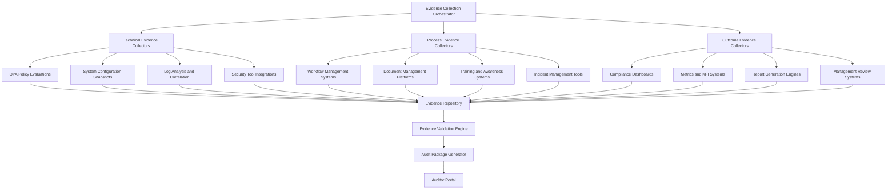

> [!WARNING]
> **STALE — flagged by the handover audit (2026-08-31).** Not verified against the current
> architecture (post-CRC lab, AAP 2.7). Findings to check: none specific — unreviewed for 293 days.
> Treat specifics as unreliable until reviewed — see
> `docs/reports/HANDOVER_AUDIT_2026-08-31.md`. Remove this banner after review.

# Audit Evidence Collection System

**Authors:** Tim Coulter & Claude
**Date:** October 15, 2025

## Automated Evidence Generation for Enterprise Compliance Audits

### Overview

This system provides automated collection, organization, and presentation of audit evidence for large enterprise compliance programs across multiple regulatory frameworks.

---

## 🎯 Evidence Collection Strategy

### Evidence Classification Framework

#### **Primary Evidence Categories**

**Design Evidence (Suitability)**
- Policy and procedure documentation
- System architecture and design documents
- Control specifications and implementation guides
- Risk assessment and control mapping documentation

**Operating Evidence (Effectiveness)**
- Control execution logs and reports
- System monitoring and alerting evidence
- Incident response and remediation records
- Performance metrics and trend analysis

**Outcome Evidence (Results)**
- Compliance test results and validation reports
- Exception reports and management responses
- Continuous monitoring dashboards
- Management review and oversight documentation

### Evidence Hierarchy by Framework

#### **PCI DSS Evidence Requirements**

```yaml
pci_dss_evidence:
  requirement_1:
    design:
      - firewall_configuration_standards.pdf
      - network_architecture_diagram.png
      - cde_segmentation_documentation.pdf
    operating:
      - firewall_rule_review_logs.json
      - network_monitoring_reports.pdf
      - quarterly_penetration_test_results.pdf
    outcome:
      - vulnerability_scan_results.json
      - compliance_dashboard_screenshots.png
      - annual_self_assessment.pdf

  requirement_3:
    design:
      - data_retention_policy.pdf
      - encryption_standards_documentation.pdf
      - key_management_procedures.pdf
    operating:
      - quarterly_data_discovery_reports.json
      - encryption_validation_logs.json
      - key_rotation_audit_trail.pdf
    outcome:
      - cardholder_data_inventory.xlsx
      - encryption_compliance_dashboard.png
      - data_destruction_certificates.pdf
```

#### **SOC 2 Evidence Requirements**

```yaml
soc2_evidence:
  security:
    design:
      - information_security_policy.pdf
      - access_control_procedures.pdf
      - incident_response_plan.pdf
    operating:
      - monthly_access_reviews.xlsx
      - security_incident_reports.pdf
      - vulnerability_management_reports.json
    outcome:
      - penetration_test_results.pdf
      - security_metrics_dashboard.png
      - management_review_minutes.pdf

  availability:
    design:
      - business_continuity_plan.pdf
      - disaster_recovery_procedures.pdf
      - capacity_management_policy.pdf
    operating:
      - system_monitoring_reports.json
      - incident_response_logs.pdf
      - capacity_utilization_metrics.xlsx
    outcome:
      - availability_sla_reports.pdf
      - dr_test_results.pdf
      - performance_dashboards.png
```

---

## 🔧 Automated Evidence Collection Framework

### Collection Architecture



### Technical Evidence Collection

#### **OPA Policy Evidence Automation**

```bash
#!/bin/bash
# OPA Evidence Collection Script

FRAMEWORK=$1
EVIDENCE_DATE=$(date +%Y%m%d)
OUTPUT_DIR="/audit-evidence/${FRAMEWORK}/${EVIDENCE_DATE}"

echo "Collecting OPA evidence for ${FRAMEWORK}..."

# Create evidence directory structure
mkdir -p ${OUTPUT_DIR}/{policies,evaluations,configurations,reports}

# Collect policy bundles
echo "Collecting policy bundles..."
tar -czf ${OUTPUT_DIR}/policies/policy_bundle_${EVIDENCE_DATE}.tar.gz policies/${FRAMEWORK}/
cp -r policies/${FRAMEWORK}/ ${OUTPUT_DIR}/policies/current_policies/

# Execute policy evaluations
echo "Executing policy evaluations..."
for test_file in test_*_input.json; do
    if [[ $test_file == *"${FRAMEWORK}"* ]]; then
        echo "Evaluating ${test_file}..."
        opa eval -d policies/${FRAMEWORK} -i ${test_file} \
            "data.${FRAMEWORK}" --format=json > \
            ${OUTPUT_DIR}/evaluations/evaluation_$(basename ${test_file} .json).json
    fi
done

# Collect OPA server metrics
echo "Collecting OPA server metrics..."
curl -s http://opa:8181/metrics > ${OUTPUT_DIR}/configurations/opa_metrics.txt
curl -s http://opa:8181/v1/status > ${OUTPUT_DIR}/configurations/opa_status.json

# Generate policy coverage report
echo "Generating policy coverage report..."
python3 scripts/generate_policy_coverage.py \
    --framework ${FRAMEWORK} \
    --output ${OUTPUT_DIR}/reports/policy_coverage_report.pdf

echo "OPA evidence collection completed for ${FRAMEWORK}"
```

#### **System Configuration Evidence**

```python
#!/usr/bin/env python3
"""
System Configuration Evidence Collector
Automatically collects system configuration evidence for compliance audits
"""

import json
import subprocess
import yaml
from datetime import datetime
from pathlib import Path

class SystemEvidenceCollector:
    def __init__(self, framework, output_dir):
        self.framework = framework
        self.output_dir = Path(output_dir)
        self.timestamp = datetime.now().isoformat()
        
    def collect_kubernetes_evidence(self):
        """Collect Kubernetes/OpenShift configuration evidence"""
        k8s_evidence = {}
        
        # Collect namespaces
        result = subprocess.run(['kubectl', 'get', 'namespaces', '-o', 'json'], 
                              capture_output=True, text=True)
        k8s_evidence['namespaces'] = json.loads(result.stdout)
        
        # Collect network policies
        result = subprocess.run(['kubectl', 'get', 'networkpolicies', '--all-namespaces', '-o', 'json'], 
                              capture_output=True, text=True)
        k8s_evidence['network_policies'] = json.loads(result.stdout)
        
        # Collect RBAC configurations
        result = subprocess.run(['kubectl', 'get', 'clusterroles,clusterrolebindings', '-o', 'json'], 
                              capture_output=True, text=True)
        k8s_evidence['rbac'] = json.loads(result.stdout)
        
        # Collect pod security policies
        result = subprocess.run(['kubectl', 'get', 'podsecuritypolicies', '-o', 'json'], 
                              capture_output=True, text=True)
        k8s_evidence['pod_security_policies'] = json.loads(result.stdout)
        
        # Save Kubernetes evidence
        with open(self.output_dir / 'kubernetes_configuration.json', 'w') as f:
            json.dump(k8s_evidence, f, indent=2)
            
    def collect_ansible_evidence(self):
        """Collect Ansible automation evidence"""
        ansible_evidence = {
            'timestamp': self.timestamp,
            'framework': self.framework,
            'playbooks': [],
            'inventory': {},
            'execution_history': []
        }
        
        # Collect playbook definitions
        playbook_path = Path(f'examples/{self.framework}-ansible-playbook.yml')
        if playbook_path.exists():
            with open(playbook_path, 'r') as f:
                ansible_evidence['playbooks'].append({
                    'name': f'{self.framework}-ansible-playbook.yml',
                    'content': yaml.safe_load(f)
                })
        
        # Collect inventory configuration
        inventory_path = Path('demo/inventory.yml')
        if inventory_path.exists():
            with open(inventory_path, 'r') as f:
                ansible_evidence['inventory'] = yaml.safe_load(f)
        
        # Save Ansible evidence
        with open(self.output_dir / 'ansible_configuration.json', 'w') as f:
            json.dump(ansible_evidence, f, indent=2)
            
    def collect_security_tool_evidence(self):
        """Collect security tool configurations and results"""
        security_evidence = {
            'timestamp': self.timestamp,
            'vulnerability_scans': [],
            'security_configurations': {},
            'monitoring_configs': {}
        }
        
        # Simulate vulnerability scan collection
        # In production, this would integrate with actual security tools
        security_evidence['vulnerability_scans'] = [
            {
                'scan_date': self.timestamp,
                'scan_type': 'infrastructure',
                'findings_summary': {
                    'critical': 0,
                    'high': 2,
                    'medium': 15,
                    'low': 23
                }
            }
        ]
        
        # Save security evidence
        with open(self.output_dir / 'security_tool_evidence.json', 'w') as f:
            json.dump(security_evidence, f, indent=2)
            
    def generate_evidence_manifest(self):
        """Generate manifest of all collected evidence"""
        evidence_files = list(self.output_dir.glob('**/*'))
        manifest = {
            'collection_timestamp': self.timestamp,
            'framework': self.framework,
            'evidence_files': [],
            'file_count': len(evidence_files),
            'total_size_bytes': sum(f.stat().st_size for f in evidence_files if f.is_file())
        }
        
        for file_path in evidence_files:
            if file_path.is_file():
                manifest['evidence_files'].append({
                    'filename': file_path.name,
                    'path': str(file_path.relative_to(self.output_dir)),
                    'size_bytes': file_path.stat().st_size,
                    'modified': datetime.fromtimestamp(file_path.stat().st_mtime).isoformat()
                })
        
        with open(self.output_dir / 'evidence_manifest.json', 'w') as f:
            json.dump(manifest, f, indent=2)
            
    def run_collection(self):
        """Execute complete evidence collection process"""
        self.output_dir.mkdir(parents=True, exist_ok=True)
        
        print(f"Starting evidence collection for {self.framework}...")
        
        self.collect_kubernetes_evidence()
        print("✓ Kubernetes evidence collected")
        
        self.collect_ansible_evidence()
        print("✓ Ansible evidence collected")
        
        self.collect_security_tool_evidence()
        print("✓ Security tool evidence collected")
        
        self.generate_evidence_manifest()
        print("✓ Evidence manifest generated")
        
        print(f"Evidence collection completed. Files saved to: {self.output_dir}")

if __name__ == "__main__":
    import sys
    if len(sys.argv) != 3:
        print("Usage: python3 system_evidence_collector.py <framework> <output_directory>")
        sys.exit(1)
        
    framework = sys.argv[1]
    output_dir = sys.argv[2]
    
    collector = SystemEvidenceCollector(framework, output_dir)
    collector.run_collection()
```

---

## 📊 Evidence Validation and Quality Assurance

### Evidence Quality Framework

#### **Evidence Quality Criteria**

**Completeness**
- All required evidence items collected
- No gaps in date ranges or coverage
- Cross-references and dependencies validated

**Accuracy**
- Evidence matches source systems
- Data integrity verification passed
- No corruption or manipulation detected

**Timeliness**
- Evidence collected within audit period
- Real-time data where required
- Historical data properly dated

**Relevance**
- Evidence directly supports control objectives
- Appropriate level of detail provided
- Unnecessary information filtered out

#### **Automated Evidence Validation**

```python
#!/usr/bin/env python3
"""
Evidence Validation Engine
Validates collected evidence for completeness, accuracy, and compliance requirements
"""

import json
import hashlib
from datetime import datetime, timedelta
from pathlib import Path

class EvidenceValidator:
    def __init__(self, framework, evidence_dir):
        self.framework = framework
        self.evidence_dir = Path(evidence_dir)
        self.validation_results = {
            'framework': framework,
            'validation_timestamp': datetime.now().isoformat(),
            'overall_status': 'PENDING',
            'checks_passed': 0,
            'checks_failed': 0,
            'validation_details': []
        }
        
    def validate_evidence_completeness(self):
        """Validate that all required evidence is present"""
        required_evidence = self.get_required_evidence_list()
        missing_evidence = []
        
        for evidence_item in required_evidence:
            evidence_path = self.evidence_dir / evidence_item['filename']
            if not evidence_path.exists():
                missing_evidence.append(evidence_item['filename'])
                
        if missing_evidence:
            self.validation_results['validation_details'].append({
                'check': 'Evidence Completeness',
                'status': 'FAILED',
                'details': f"Missing evidence files: {', '.join(missing_evidence)}"
            })
            self.validation_results['checks_failed'] += 1
        else:
            self.validation_results['validation_details'].append({
                'check': 'Evidence Completeness',
                'status': 'PASSED',
                'details': 'All required evidence files present'
            })
            self.validation_results['checks_passed'] += 1
            
    def validate_evidence_integrity(self):
        """Validate evidence file integrity using checksums"""
        evidence_files = list(self.evidence_dir.glob('**/*'))
        corrupted_files = []
        
        for file_path in evidence_files:
            if file_path.is_file() and file_path.suffix in ['.json', '.pdf', '.xlsx']:
                # Calculate file hash
                file_hash = self.calculate_file_hash(file_path)
                
                # Validate file can be opened/parsed
                try:
                    if file_path.suffix == '.json':
                        with open(file_path, 'r') as f:
                            json.load(f)
                    # Add other file type validations as needed
                except Exception as e:
                    corrupted_files.append(f"{file_path.name}: {str(e)}")
                    
        if corrupted_files:
            self.validation_results['validation_details'].append({
                'check': 'Evidence Integrity',
                'status': 'FAILED',
                'details': f"Corrupted files detected: {', '.join(corrupted_files)}"
            })
            self.validation_results['checks_failed'] += 1
        else:
            self.validation_results['validation_details'].append({
                'check': 'Evidence Integrity',
                'status': 'PASSED',
                'details': 'All evidence files passed integrity checks'
            })
            self.validation_results['checks_passed'] += 1
            
    def validate_evidence_timeliness(self):
        """Validate evidence is within required time periods"""
        audit_period_start = datetime.now() - timedelta(days=365)
        outdated_evidence = []
        
        evidence_files = list(self.evidence_dir.glob('**/*.json'))
        for file_path in evidence_files:
            file_mtime = datetime.fromtimestamp(file_path.stat().st_mtime)
            if file_mtime < audit_period_start:
                outdated_evidence.append(file_path.name)
                
        if outdated_evidence:
            self.validation_results['validation_details'].append({
                'check': 'Evidence Timeliness',
                'status': 'WARNING',
                'details': f"Potentially outdated evidence: {', '.join(outdated_evidence)}"
            })
        else:
            self.validation_results['validation_details'].append({
                'check': 'Evidence Timeliness',
                'status': 'PASSED',
                'details': 'All evidence within required time periods'
            })
            self.validation_results['checks_passed'] += 1
            
    def calculate_file_hash(self, file_path):
        """Calculate SHA-256 hash of file for integrity verification"""
        sha256_hash = hashlib.sha256()
        with open(file_path, "rb") as f:
            for byte_block in iter(lambda: f.read(4096), b""):
                sha256_hash.update(byte_block)
        return sha256_hash.hexdigest()
        
    def get_required_evidence_list(self):
        """Get list of required evidence based on framework"""
        evidence_requirements = {
            'pci_dss': [
                {'filename': 'kubernetes_configuration.json', 'type': 'technical'},
                {'filename': 'ansible_configuration.json', 'type': 'technical'},
                {'filename': 'security_tool_evidence.json', 'type': 'technical'},
                {'filename': 'policy_coverage_report.pdf', 'type': 'outcome'}
            ],
            'soc2': [
                {'filename': 'kubernetes_configuration.json', 'type': 'technical'},
                {'filename': 'ansible_configuration.json', 'type': 'technical'},
                {'filename': 'security_tool_evidence.json', 'type': 'technical'},
                {'filename': 'infrastructure_evidence.json', 'type': 'technical'}
            ]
        }
        return evidence_requirements.get(self.framework, [])
        
    def run_validation(self):
        """Execute complete evidence validation process"""
        print(f"Starting evidence validation for {self.framework}...")
        
        self.validate_evidence_completeness()
        self.validate_evidence_integrity()
        self.validate_evidence_timeliness()
        
        # Determine overall status
        if self.validation_results['checks_failed'] > 0:
            self.validation_results['overall_status'] = 'FAILED'
        elif any(check['status'] == 'WARNING' for check in self.validation_results['validation_details']):
            self.validation_results['overall_status'] = 'WARNING'
        else:
            self.validation_results['overall_status'] = 'PASSED'
            
        # Save validation results
        validation_file = self.evidence_dir / 'validation_results.json'
        with open(validation_file, 'w') as f:
            json.dump(self.validation_results, f, indent=2)
            
        print(f"Evidence validation completed. Status: {self.validation_results['overall_status']}")
        return self.validation_results

if __name__ == "__main__":
    import sys
    if len(sys.argv) != 3:
        print("Usage: python3 evidence_validator.py <framework> <evidence_directory>")
        sys.exit(1)
        
    framework = sys.argv[1]
    evidence_dir = sys.argv[2]
    
    validator = EvidenceValidator(framework, evidence_dir)
    results = validator.run_validation()
    
    print(f"Validation Summary:")
    print(f"  Checks Passed: {results['checks_passed']}")
    print(f"  Checks Failed: {results['checks_failed']}")
    print(f"  Overall Status: {results['overall_status']}")
```

---

## 📁 Evidence Repository Management

### Evidence Storage Architecture

#### **Repository Structure**

```
audit-evidence/
├── frameworks/
│   ├── pci_dss/
│   │   ├── 2024-q1/
│   │   ├── 2024-q2/
│   │   └── 2024-q3/
│   ├── soc2/
│   │   ├── 2024-type1/
│   │   └── 2024-type2/
│   └── iso27001/
│       ├── 2024-annual/
│       └── 2025-annual/
├── templates/
│   ├── evidence_templates/
│   ├── report_templates/
│   └── audit_packages/
└── archives/
    ├── completed_audits/
    ├── historical_evidence/
    └── retention_schedules/
```

#### **Evidence Metadata Management**

```yaml
# Evidence Metadata Schema
evidence_metadata:
  evidence_id: "EVD-PCI-2024-Q3-001"
  framework: "PCI_DSS"
  audit_period: "2024-Q3"
  collection_date: "2024-09-15T10:30:00Z"
  evidence_type: "technical"
  classification: "confidential"
  
  source_system:
    name: "OpenShift Cluster"
    version: "4.12"
    location: "us-east-1"
    
  collector:
    type: "automated"
    script: "system_evidence_collector.py"
    version: "2.1.0"
    
  validation:
    status: "passed"
    timestamp: "2024-09-15T11:00:00Z"
    checksum: "sha256:abc123..."
    
  retention:
    period_years: 7
    destruction_date: "2031-09-15"
    legal_hold: false
    
  access_control:
    classification: "restricted"
    authorized_roles: ["auditor", "compliance_manager"]
    encryption: "AES-256"
```

### Evidence Retention and Lifecycle Management

#### **Retention Schedule by Framework**

| Framework | Retention Period | Storage Location | Access Controls |
|-----------|------------------|------------------|-----------------|
| PCI DSS | 7 years | Encrypted cloud storage | Auditor, CISO |
| SOC 2 | 5 years | Encrypted cloud storage | Auditor, Compliance Team |
| ISO 27001 | 6 years | Encrypted cloud storage | Auditor, Risk Team |
| NIST CSF | 5 years | Encrypted cloud storage | Auditor, Security Team |

#### **Automated Lifecycle Management**

```python
#!/usr/bin/env python3
"""
Evidence Lifecycle Manager
Manages evidence retention, archival, and destruction based on policy requirements
"""

import json
from datetime import datetime, timedelta
from pathlib import Path

class EvidenceLifecycleManager:
    def __init__(self, evidence_repository):
        self.evidence_repository = Path(evidence_repository)
        self.retention_policies = self.load_retention_policies()
        
    def load_retention_policies(self):
        """Load retention policies for different frameworks"""
        return {
            'pci_dss': {'retention_years': 7, 'classification': 'restricted'},
            'soc2': {'retention_years': 5, 'classification': 'confidential'},
            'iso27001': {'retention_years': 6, 'classification': 'confidential'},
            'nist_csf': {'retention_years': 5, 'classification': 'internal'}
        }
        
    def identify_expired_evidence(self):
        """Identify evidence that has exceeded retention period"""
        expired_evidence = []
        current_date = datetime.now()
        
        for framework_dir in self.evidence_repository.glob('frameworks/*/'):
            framework = framework_dir.name
            if framework in self.retention_policies:
                retention_period = timedelta(days=365 * self.retention_policies[framework]['retention_years'])
                
                for evidence_dir in framework_dir.glob('*/'):
                    # Check metadata for collection date
                    metadata_file = evidence_dir / 'evidence_metadata.json'
                    if metadata_file.exists():
                        with open(metadata_file, 'r') as f:
                            metadata = json.load(f)
                            
                        collection_date = datetime.fromisoformat(metadata['collection_date'].replace('Z', '+00:00'))
                        if current_date - collection_date > retention_period:
                            expired_evidence.append({
                                'path': str(evidence_dir),
                                'framework': framework,
                                'collection_date': collection_date.isoformat(),
                                'days_expired': (current_date - collection_date - retention_period).days
                            })
                            
        return expired_evidence
        
    def archive_evidence(self, evidence_path):
        """Archive evidence to long-term storage"""
        # Implementation would move evidence to archive storage
        # and update metadata with archive location
        pass
        
    def destroy_evidence(self, evidence_path):
        """Securely destroy evidence that has exceeded retention"""
        # Implementation would securely delete evidence files
        # and log destruction for audit trail
        pass

if __name__ == "__main__":
    manager = EvidenceLifecycleManager('/audit-evidence')
    expired = manager.identify_expired_evidence()
    
    if expired:
        print(f"Found {len(expired)} expired evidence collections:")
        for item in expired:
            print(f"  {item['framework']}: {item['path']} (expired {item['days_expired']} days)")
    else:
        print("No expired evidence found")
```

---

## 🚀 Auditor Portal and Self-Service

### Auditor Access Framework

#### **Role-Based Access Control**

```yaml
# Auditor Portal RBAC Configuration
rbac_roles:
  external_auditor:
    permissions:
      - view_evidence
      - download_evidence
      - request_additional_evidence
      - submit_findings
    restrictions:
      - no_system_access
      - read_only_evidence
      - audit_trail_logged
      
  internal_auditor:
    permissions:
      - view_evidence
      - download_evidence
      - request_additional_evidence
      - submit_findings
      - view_system_configurations
    restrictions:
      - audit_trail_logged
      - manager_approval_required
      
  compliance_manager:
    permissions:
      - view_evidence
      - download_evidence
      - approve_evidence_requests
      - manage_audit_schedules
      - configure_evidence_collection
    restrictions:
      - audit_trail_logged
      
  system_administrator:
    permissions:
      - configure_evidence_collection
      - manage_auditor_access
      - system_maintenance
      - backup_management
    restrictions:
      - dual_approval_required
      - security_clearance_verified
```

#### **Self-Service Evidence Portal**

```html
<!-- Auditor Self-Service Portal Interface -->
<!DOCTYPE html>
<html lang="en">
<head>
    <title>Enterprise Compliance Evidence Portal</title>
    <meta charset="UTF-8">
    <meta name="viewport" content="width=device-width, initial-scale=1.0">
    <link rel="stylesheet" href="css/audit-portal.css">
</head>
<body>
    <header class="portal-header">
        <h1>Compliance Evidence Portal</h1>
        <nav>
            <ul>
                <li><a href="#dashboard">Dashboard</a></li>
                <li><a href="#evidence">Evidence Library</a></li>
                <li><a href="#requests">Requests</a></li>
                <li><a href="#reports">Reports</a></li>
            </ul>
        </nav>
    </header>

    <main class="portal-content">
        <section id="dashboard" class="dashboard">
            <h2>Audit Dashboard</h2>
            <div class="dashboard-grid">
                <div class="dashboard-card">
                    <h3>Evidence Collections</h3>
                    <div class="metric">
                        <span class="value">156</span>
                        <span class="label">Total Collections</span>
                    </div>
                </div>
                <div class="dashboard-card">
                    <h3>Frameworks</h3>
                    <ul class="framework-list">
                        <li>PCI DSS <span class="status complete">Complete</span></li>
                        <li>SOC 2 <span class="status in-progress">In Progress</span></li>
                        <li>ISO 27001 <span class="status pending">Pending</span></li>
                    </ul>
                </div>
                <div class="dashboard-card">
                    <h3>Recent Activity</h3>
                    <ul class="activity-list">
                        <li>Evidence collection completed - PCI DSS Q3</li>
                        <li>Validation passed - SOC 2 Security</li>
                        <li>New evidence request - ISO 27001</li>
                    </ul>
                </div>
            </div>
        </section>

        <section id="evidence" class="evidence-library">
            <h2>Evidence Library</h2>
            <div class="evidence-filters">
                <select id="framework-filter">
                    <option value="">All Frameworks</option>
                    <option value="pci_dss">PCI DSS</option>
                    <option value="soc2">SOC 2</option>
                    <option value="iso27001">ISO 27001</option>
                </select>
                <select id="period-filter">
                    <option value="">All Periods</option>
                    <option value="2024-q3">2024 Q3</option>
                    <option value="2024-q2">2024 Q2</option>
                    <option value="2024-q1">2024 Q1</option>
                </select>
                <input type="text" id="search-evidence" placeholder="Search evidence...">
            </div>
            
            <table class="evidence-table">
                <thead>
                    <tr>
                        <th>Evidence ID</th>
                        <th>Framework</th>
                        <th>Type</th>
                        <th>Collection Date</th>
                        <th>Status</th>
                        <th>Actions</th>
                    </tr>
                </thead>
                <tbody id="evidence-list">
                    <!-- Evidence items populated by JavaScript -->
                </tbody>
            </table>
        </section>
    </main>

    <script src="js/audit-portal.js"></script>
</body>
</html>
```

#### **Evidence Request Workflow**

```python
#!/usr/bin/env python3
"""
Evidence Request Management System
Handles auditor requests for additional evidence and automated collection
"""

from enum import Enum
from datetime import datetime
import json

class RequestStatus(Enum):
    SUBMITTED = "submitted"
    APPROVED = "approved"
    IN_PROGRESS = "in_progress"
    COMPLETED = "completed"
    REJECTED = "rejected"

class EvidenceRequest:
    def __init__(self, request_id, auditor_id, framework, evidence_type, description):
        self.request_id = request_id
        self.auditor_id = auditor_id
        self.framework = framework
        self.evidence_type = evidence_type
        self.description = description
        self.status = RequestStatus.SUBMITTED
        self.created_date = datetime.now()
        self.workflow_history = []
        
    def approve_request(self, approver_id, notes=""):
        """Approve evidence request"""
        self.status = RequestStatus.APPROVED
        self.workflow_history.append({
            'action': 'approved',
            'actor': approver_id,
            'timestamp': datetime.now().isoformat(),
            'notes': notes
        })
        
    def start_collection(self, collector_id):
        """Start evidence collection process"""
        self.status = RequestStatus.IN_PROGRESS
        self.workflow_history.append({
            'action': 'collection_started',
            'actor': collector_id,
            'timestamp': datetime.now().isoformat()
        })
        
    def complete_collection(self, evidence_location):
        """Complete evidence collection"""
        self.status = RequestStatus.COMPLETED
        self.evidence_location = evidence_location
        self.workflow_history.append({
            'action': 'collection_completed',
            'timestamp': datetime.now().isoformat(),
            'evidence_location': evidence_location
        })

class EvidenceRequestManager:
    def __init__(self):
        self.requests = {}
        self.auto_approval_rules = self.load_auto_approval_rules()
        
    def submit_request(self, auditor_id, framework, evidence_type, description):
        """Submit new evidence request"""
        request_id = f"REQ-{datetime.now().strftime('%Y%m%d')}-{len(self.requests) + 1:03d}"
        
        request = EvidenceRequest(
            request_id=request_id,
            auditor_id=auditor_id,
            framework=framework,
            evidence_type=evidence_type,
            description=description
        )
        
        self.requests[request_id] = request
        
        # Check for auto-approval
        if self.check_auto_approval(request):
            request.approve_request('system', 'Auto-approved based on predefined rules')
            self.trigger_collection(request)
            
        return request_id
        
    def check_auto_approval(self, request):
        """Check if request qualifies for automatic approval"""
        for rule in self.auto_approval_rules:
            if (rule['framework'] == request.framework and 
                rule['evidence_type'] == request.evidence_type):
                return True
        return False
        
    def trigger_collection(self, request):
        """Trigger automated evidence collection"""
        request.start_collection('automation_system')
        
        # Execute collection script based on request type
        collection_script = f"collect_{request.framework}_{request.evidence_type}.py"
        evidence_location = f"/audit-evidence/{request.framework}/{request.request_id}/"
        
        # In production, this would execute the actual collection
        # subprocess.run(['python3', f'scripts/{collection_script}', evidence_location])
        
        request.complete_collection(evidence_location)
        
    def load_auto_approval_rules(self):
        """Load auto-approval rules configuration"""
        return [
            {'framework': 'pci_dss', 'evidence_type': 'system_configuration'},
            {'framework': 'soc2', 'evidence_type': 'access_logs'},
            {'framework': 'iso27001', 'evidence_type': 'policy_documents'}
        ]

# Example usage
if __name__ == "__main__":
    manager = EvidenceRequestManager()
    
    # Submit evidence request
    request_id = manager.submit_request(
        auditor_id="AUD001",
        framework="pci_dss",
        evidence_type="system_configuration",
        description="Need current firewall configurations for Q3 audit"
    )
    
    print(f"Evidence request submitted: {request_id}")
    print(f"Status: {manager.requests[request_id].status.value}")
```

---

This automated audit evidence collection system provides enterprise-grade capabilities for large organizations to efficiently manage compliance audits across multiple regulatory frameworks while ensuring evidence quality, security, and auditor satisfaction.