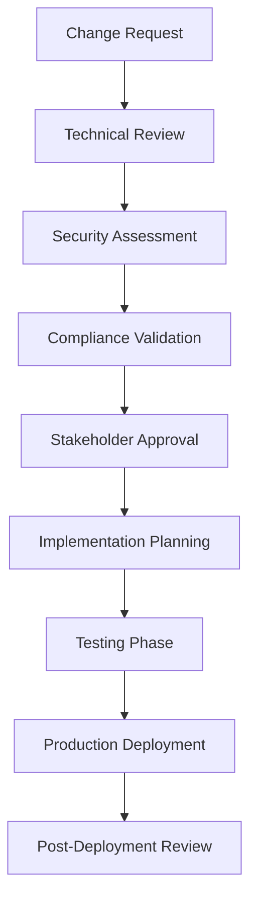

> [!WARNING]
> **STALE — flagged by the handover audit (2026-08-31).** Not verified against the current
> architecture (post-CRC lab, AAP 2.7). Findings to check: none specific — unreviewed for 293 days.
> Treat specifics as unreliable until reviewed — see
> `docs/reports/HANDOVER_AUDIT_2026-08-31.md`. Remove this banner after review.

# Compliance Library Update Schedule

**Authors:** Tim Coulter & Claude
**Date:** October 15, 2025

## Maintenance and Evolution Strategy for Multi-Framework Compliance

### Overview

This document defines the update schedule, maintenance procedures, and versioning strategy for the comprehensive compliance library covering CIS, NIST, ISO 27001, SOC 2, and PCI DSS frameworks.

---

## 🗓️ Update Frequency by Framework

### High-Priority Frameworks (Quarterly Updates)

#### **PCI DSS**
- **Update Frequency**: Quarterly
- **Reason**: Payment security critical, frequent threat landscape changes
- **Schedule**: January, April, July, October
- **Lead Time**: 30 days before quarter end
- **Components**:
  - Cardholder data environment controls
  - Network security requirements
  - Encryption standards updates
  - New vulnerability patterns

#### **SOC 2**
- **Update Frequency**: Quarterly  
- **Reason**: Service organization audits, evolving cloud security practices
- **Schedule**: February, May, August, November
- **Lead Time**: 45 days before audit cycles
- **Components**:
  - Trust service criteria updates
  - Cloud security controls
  - Infrastructure automation policies
  - Incident response procedures

### Medium-Priority Frameworks (Bi-Annual Updates)

#### **ISO 27001**
- **Update Frequency**: Bi-annually
- **Reason**: International standard, stable but evolving
- **Schedule**: March, September
- **Lead Time**: 60 days for policy review
- **Components**:
  - Annex A control updates
  - Risk management procedures
  - Information security management
  - Supply chain security

#### **NIST Cybersecurity Framework**
- **Update Frequency**: Bi-annually
- **Reason**: Government standards, structured release cycles
- **Schedule**: April, October  
- **Lead Time**: 90 days for stakeholder review
- **Components**:
  - Framework 2.0 governance updates
  - Supply chain risk management
  - Critical infrastructure protection
  - Zero trust architecture alignment

### Standard-Priority Frameworks (Annual Updates)

#### **CIS Benchmarks**
- **Update Frequency**: Annually
- **Reason**: Technical benchmarks, stable configurations
- **Schedule**: January (major), July (minor)
- **Lead Time**: 120 days for testing
- **Components**:
  - Operating system hardening
  - Container security benchmarks
  - Cloud platform configurations
  - Network device security

---

## 📋 Monthly Maintenance Schedule

### Week 1: Framework Monitoring
- **Monday**: Review framework update announcements
- **Tuesday**: Assess impact of regulatory changes
- **Wednesday**: Evaluate new threat intelligence
- **Thursday**: Update threat models and risk assessments
- **Friday**: Document findings and recommendations

### Week 2: Policy Development
- **Monday**: Draft new policy requirements
- **Tuesday**: Update existing OPA rego policies
- **Wednesday**: Develop Ansible Automation Platform collection playbooks
- **Thursday**: Create test scenarios and validation
- **Friday**: Peer review and technical documentation

### Week 3: Testing and Validation
- **Monday**: Unit testing of individual policies
- **Tuesday**: Integration testing across frameworks
- **Wednesday**: Performance testing at scale
- **Thursday**: Security testing and validation
- **Friday**: User acceptance testing with stakeholders

### Week 4: Deployment and Documentation
- **Monday**: Staging environment deployment
- **Tuesday**: Production deployment planning
- **Wednesday**: Documentation updates and training
- **Thursday**: Stakeholder communication and rollout
- **Friday**: Post-deployment monitoring and feedback

---

## 🔄 Versioning Strategy

### Semantic Versioning Format
```
MAJOR.MINOR.PATCH-FRAMEWORK
```

**Examples:**
- `2.1.3-cis` - CIS Benchmarks version 2.1.3
- `1.4.2-pci` - PCI DSS version 1.4.2  
- `3.0.1-soc2` - SOC 2 version 3.0.1

### Version Increment Rules

#### **MAJOR** (X.0.0)
- New framework addition
- Breaking policy changes
- Architecture redesign
- Incompatible API changes

#### **MINOR** (1.Y.0)
- New requirements added
- Enhanced automation features
- Additional compliance controls
- Backward-compatible improvements

#### **PATCH** (1.1.Z)
- Bug fixes and corrections
- Policy refinements
- Documentation updates
- Performance optimizations

### Release Branches Strategy

```bash
# Main development branch
git checkout main

# Feature development
git checkout -b feature/pci-requirement-4
git checkout -b feature/soc2-infrastructure

# Release preparation
git checkout -b release/v2.1.0
git checkout -b hotfix/critical-security-fix

# Tagged releases
git tag -a v2.1.0-pci -m "PCI DSS v4.0 Q2 2024 Update"
git tag -a v3.0.1-soc2 -m "SOC 2 Infrastructure Controls Update"
```

---

## 📊 Update Tracking Matrix

### Q1 2024 Schedule

| Week | Framework | Activity | Deliverable | Owner |
|------|-----------|----------|-------------|-------|
| Jan W1 | PCI DSS | v4.0 Analysis | Gap Assessment | Security Team |
| Jan W2 | PCI DSS | Policy Updates | OPA Rego Policies | DevOps Team |
| Jan W3 | PCI DSS | Testing | Validation Report | QA Team |
| Jan W4 | PCI DSS | Deployment | Production Release | Platform Team |
| Feb W1 | SOC 2 | 2024 Updates | Control Matrix | Compliance Team |
| Feb W2 | SOC 2 | Infrastructure | AAP Playbooks | Infrastructure Team |
| Feb W3 | SOC 2 | Integration | End-to-End Testing | QA Team |
| Feb W4 | SOC 2 | Release | Documentation | Technical Writers |
| Mar W1 | ISO 27001 | 2022 Review | Control Assessment | Risk Team |
| Mar W2 | ISO 27001 | Policy Refresh | Updated Policies | Security Team |
| Mar W3 | ISO 27001 | Validation | Compliance Testing | Audit Team |
| Mar W4 | ISO 27001 | Deployment | Stakeholder Training | Training Team |

### Annual Roadmap

#### **2024 Priorities**
- **Q1**: PCI DSS v4.0 implementation, SOC 2 infrastructure expansion
- **Q2**: NIST CSF 2.0 alignment, CIS Benchmarks v8.0 adoption
- **Q3**: ISO 27001:2022 full implementation, cloud security updates
- **Q4**: Cross-framework harmonization, AI/ML governance integration

#### **2025 Roadmap**
- **Q1**: Quantum-safe cryptography preparation
- **Q2**: Supply chain security framework (SSDF)
- **Q3**: Zero trust architecture compliance
- **Q4**: Cloud-native security frameworks

---

## 🔍 Change Management Process

### 1. Impact Assessment

```yaml
# Change Impact Template
change_request:
  id: "CHG-2024-001"
  framework: "PCI DSS"
  type: "requirement_update"
  urgency: "high"
  business_impact: "payment_processing"
  technical_impact: "encryption_standards"
  risk_level: "medium"
  stakeholders: ["security", "compliance", "devops"]
  timeline: "30_days"
```

### 2. Approval Workflow



### 3. Rollback Procedures

```bash
#!/bin/bash
# Emergency rollback script

PREVIOUS_VERSION=$1
FRAMEWORK=$2

echo "Initiating rollback to version $PREVIOUS_VERSION for $FRAMEWORK"

# Stop current services
kubectl scale deployment opa-$FRAMEWORK --replicas=0

# Restore previous policy bundle
kubectl apply -f backups/opa-policies-$PREVIOUS_VERSION.yaml

# Restart services
kubectl scale deployment opa-$FRAMEWORK --replicas=3

# Verify rollback
./scripts/validate-compliance.sh $FRAMEWORK $PREVIOUS_VERSION
```

---

## 📈 Metrics and KPIs

### Update Success Metrics

| Metric | Target | Measurement |
|--------|--------|-------------|
| Update Delivery Time | 95% on schedule | Days from planned to actual |
| Policy Accuracy | 99.5% | Validation test pass rate |
| Zero Downtime Deployments | 100% | Production incident count |
| Stakeholder Satisfaction | 4.5/5 | Quarterly survey results |
| Compliance Coverage | 100% | Framework requirement coverage |

### Performance Monitoring

```promql
# Policy update deployment success rate
rate(policy_deployment_success_total[7d]) / 
rate(policy_deployment_total[7d])

# Average time to deploy updates
histogram_quantile(0.95, 
  rate(policy_deployment_duration_seconds_bucket[7d]))

# Framework coverage completeness
(framework_requirements_implemented / framework_requirements_total) * 100
```

---

## 🚨 Emergency Update Procedures

### Critical Security Updates

1. **Immediate Response (0-4 hours)**
   - Security team assessment
   - Impact analysis
   - Emergency change approval
   - Hotfix development

2. **Rapid Deployment (4-24 hours)**
   - Accelerated testing
   - Staged rollout
   - Continuous monitoring
   - Stakeholder communication

3. **Post-Incident (24-72 hours)**
   - Root cause analysis
   - Process improvement
   - Documentation update
   - Lessons learned review

### Communication Templates

```yaml
# Emergency Update Notification
subject: "URGENT: Compliance Framework Emergency Update"
recipients: ["security-team", "compliance-team", "platform-team"]
template: |
  Critical security update required for {{framework}}
  
  Issue: {{vulnerability_description}}
  Impact: {{business_impact}}
  Timeline: {{update_schedule}}
  
  Action Required:
  - Review impact assessment
  - Approve emergency change
  - Validate post-deployment
  
  Contact: {{incident_commander}}
```

---

## 📚 Training and Knowledge Transfer

### Quarterly Training Schedule

#### **Technical Training**
- **Month 1**: OPA policy development and Rego language
- **Month 2**: Ansible Automation Platform automation and playbook development  
- **Month 3**: Compliance framework deep-dive sessions

#### **Business Training**
- **Month 1**: Regulatory update briefings
- **Month 2**: Risk assessment methodology
- **Month 3**: Audit preparation and evidence collection

### Documentation Requirements

```markdown
# Required Documentation per Update

## Technical Documentation
- [ ] Policy change specifications
- [ ] Implementation guidelines
- [ ] Testing procedures
- [ ] Deployment instructions
- [ ] Troubleshooting guide

## Business Documentation  
- [ ] Compliance mapping
- [ ] Risk assessment updates
- [ ] Stakeholder communication
- [ ] Training materials
- [ ] Audit evidence preparation
```

---

## 🔧 Automation and Tooling

### Automated Update Pipeline

```yaml
# GitHub Actions Workflow
name: Compliance Framework Update
on:
  schedule:
    - cron: '0 0 1 */3 *'  # Quarterly
  workflow_dispatch:

jobs:
  framework-update:
    runs-on: ubuntu-latest
    steps:
    - name: Check Framework Updates
      run: ./scripts/check-framework-updates.sh
      
    - name: Update Policies
      run: ./scripts/update-policies.sh
      
    - name: Run Tests
      run: ./scripts/run-compliance-tests.sh
      
    - name: Deploy to Staging
      run: ./scripts/deploy-staging.sh
      
    - name: Notify Stakeholders
      run: ./scripts/send-notifications.sh
```

### Monitoring and Alerting

```yaml
# Prometheus Alerting Rules
groups:
- name: compliance_updates
  rules:
  - alert: FrameworkUpdateAvailable
    expr: framework_update_available == 1
    for: 24h
    labels:
      severity: warning
    annotations:
      summary: "Framework update available for {{ $labels.framework }}"
      
  - alert: PolicyValidationFailed
    expr: policy_validation_success_rate < 0.95
    for: 5m
    labels:
      severity: critical
    annotations:
      summary: "Policy validation failing for {{ $labels.framework }}"
```

---

This comprehensive update schedule ensures your compliance library remains current, secure, and aligned with evolving regulatory requirements while maintaining operational excellence.