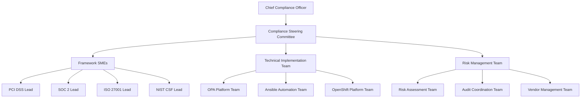

> [!WARNING]
> **STALE — flagged by the handover audit (2026-08-31).** Not verified against the current
> architecture (post-CRC lab, AAP 2.7). Findings to check: none specific — unreviewed for 293 days.
> Treat specifics as unreliable until reviewed — see
> `docs/reports/HANDOVER_AUDIT_2026-08-31.md`. Remove this banner after review.

# Enterprise Compliance Governance Framework

**Authors:** Tim Coulter & Claude
**Date:** October 15, 2025

## Comprehensive Compliance Management for Large Organizations

### Executive Summary

This governance framework provides large organizations with a structured approach to implementing, managing, and maintaining compliance across multiple regulatory frameworks using automated policy enforcement and continuous monitoring.

---

## 🏢 Enterprise Compliance Architecture

### Organizational Structure



### Governance Hierarchy

#### **Level 1: Executive Governance**
- **Chief Compliance Officer (CCO)**: Overall compliance strategy and accountability
- **Risk Committee**: Enterprise risk oversight and compliance investment decisions
- **Audit Committee**: Independent oversight and validation of compliance programs

#### **Level 2: Operational Governance**
- **Compliance Steering Committee**: Cross-functional compliance coordination
- **Technical Architecture Review Board**: Platform and tooling decisions
- **Data Governance Council**: Data classification and protection oversight

#### **Level 3: Framework Implementation**
- **Framework Subject Matter Experts**: Domain-specific compliance expertise
- **Platform Engineering Teams**: Technical implementation and automation
- **Business Unit Compliance Teams**: Local implementation and monitoring

---

## 📋 Compliance Program Management

### RACI Matrix for Large Organizations

| Activity | CCO | Compliance Team | Platform Team | Business Units | Legal | Audit |
|----------|-----|-----------------|---------------|----------------|-------|-------|
| Policy Development | A | R | C | C | C | I |
| Technical Implementation | A | R | R | C | I | I |
| Risk Assessment | A | R | C | R | C | I |
| Audit Preparation | A | R | C | R | C | R |
| Incident Response | A | R | R | I | C | I |
| Vendor Assessment | A | R | I | C | R | C |
| Training & Awareness | A | R | C | R | I | I |
| Continuous Monitoring | A | R | R | I | I | C |

*R=Responsible, A=Accountable, C=Consulted, I=Informed*

### Compliance Operating Model

#### **Three Lines of Defense**

**First Line: Business Operations**
- Business unit compliance managers
- Process owners and control operators
- Day-to-day compliance activities
- Self-assessment and monitoring

**Second Line: Compliance and Risk**
- Compliance function oversight
- Risk management activities
- Policy development and interpretation
- Independent testing and validation

**Third Line: Internal Audit**
- Independent assurance activities
- Audit of compliance programs
- Validation of control effectiveness
- Reporting to audit committee

---

## 🎯 Multi-Framework Compliance Strategy

### Framework Prioritization Matrix

| Framework | Business Impact | Regulatory Risk | Implementation Complexity | Priority |
|-----------|-----------------|-----------------|---------------------------|----------|
| PCI DSS | Critical | High | High | P0 |
| SOC 2 | Critical | High | Medium | P0 |
| ISO 27001 | High | Medium | High | P1 |
| NIST CSF | Medium | Medium | Medium | P1 |
| CIS Benchmarks | Medium | Low | Low | P2 |

### Cross-Framework Mapping

```yaml
# Control Overlap Analysis
shared_controls:
  access_management:
    frameworks: ["PCI_DSS", "SOC2", "ISO27001", "NIST_CSF"]
    automation_priority: "HIGH"
    business_value: "Maximum efficiency through shared implementation"
    
  encryption_controls:
    frameworks: ["PCI_DSS", "SOC2", "ISO27001"]
    automation_priority: "HIGH"
    business_value: "Consistent data protection across frameworks"
    
  vulnerability_management:
    frameworks: ["PCI_DSS", "ISO27001", "NIST_CSF", "CIS"]
    automation_priority: "MEDIUM"
    business_value: "Unified vulnerability lifecycle management"
    
  incident_response:
    frameworks: ["SOC2", "ISO27001", "NIST_CSF"]
    automation_priority: "MEDIUM"
    business_value: "Streamlined incident handling processes"
```

### Implementation Roadmap for Large Organizations

#### **Phase 1: Foundation (Months 1-6)**
- **Objective**: Establish governance and baseline security
- **Deliverables**:
  - Compliance governance structure
  - CIS Benchmarks baseline implementation
  - OPA platform deployment and scaling
  - Initial risk assessment and gap analysis

#### **Phase 2: Critical Compliance (Months 7-12)**
- **Objective**: Implement business-critical compliance frameworks
- **Deliverables**:
  - PCI DSS implementation for payment processing
  - SOC 2 Type II readiness for customer assurance
  - Automated continuous monitoring implementation
  - Executive dashboard and reporting

#### **Phase 3: Comprehensive Coverage (Months 13-18)**
- **Objective**: Complete multi-framework implementation
- **Deliverables**:
  - ISO 27001 certification readiness
  - NIST CSF implementation
  - Cross-framework optimization and harmonization
  - Advanced analytics and predictive compliance

#### **Phase 4: Optimization and Innovation (Months 19-24)**
- **Objective**: Continuous improvement and emerging requirements
- **Deliverables**:
  - AI/ML-powered compliance insights
  - Supply chain compliance integration
  - Regulatory change management automation
  - Compliance-as-a-Service capabilities

---

## 📊 Enterprise Metrics and KPIs

### Strategic KPIs for Executive Leadership

#### **Compliance Effectiveness**
```yaml
metrics:
  overall_compliance_score:
    target: ">95%"
    measurement: "Monthly weighted average across all frameworks"
    
  audit_findings_trend:
    target: "<5 high-risk findings per audit"
    measurement: "Quarterly independent audit results"
    
  regulatory_incident_count:
    target: "Zero material incidents"
    measurement: "Annual regulatory reporting period"
    
  compliance_cost_optimization:
    target: "10% annual efficiency gain"
    measurement: "Cost per compliance control implementation"
```

#### **Operational KPIs for Management**
```yaml
metrics:
  control_automation_rate:
    target: ">80%"
    measurement: "Percentage of controls with automated validation"
    
  remediation_time:
    target: "<30 days for high-risk issues"
    measurement: "Average time from detection to resolution"
    
  policy_coverage:
    target: "100% of in-scope systems"
    measurement: "Systems with active compliance monitoring"
    
  staff_compliance_training:
    target: "100% completion rate"
    measurement: "Annual compliance training completion"
```

### Reporting Framework

#### **Executive Dashboard Components**
1. **Compliance Posture Overview**
   - Real-time compliance scores by framework
   - Trend analysis and predictive insights
   - Risk heat map by business unit
   - Regulatory change impact assessment

2. **Operational Metrics**
   - Control effectiveness monitoring
   - Incident and exception tracking
   - Audit readiness status
   - Resource utilization and costs

3. **Strategic Insights**
   - Business impact analysis
   - Competitive compliance positioning
   - Regulatory landscape changes
   - Investment prioritization recommendations

---

## 🔒 Risk Management Integration

### Enterprise Risk Assessment Framework

#### **Risk Categories for Large Organizations**

**Regulatory Risk**
- Financial penalties and sanctions
- License and certification impacts
- Reputational damage
- Operational restrictions

**Operational Risk**
- Business process disruptions
- System availability impacts
- Data breach consequences
- Third-party vendor risks

**Strategic Risk**
- Market access limitations
- Competitive disadvantage
- Customer trust erosion
- Innovation constraints

### Risk Quantification Model

```python
# Enterprise Risk Scoring Algorithm
def calculate_enterprise_risk_score(framework, business_unit):
    risk_factors = {
        'regulatory_exposure': get_regulatory_exposure(framework, business_unit),
        'business_impact': get_business_impact(business_unit),
        'control_maturity': get_control_maturity(framework, business_unit),
        'threat_landscape': get_threat_landscape(framework),
        'incident_history': get_incident_history(business_unit)
    }
    
    weights = {
        'regulatory_exposure': 0.30,
        'business_impact': 0.25,
        'control_maturity': 0.20,
        'threat_landscape': 0.15,
        'incident_history': 0.10
    }
    
    risk_score = sum(risk_factors[factor] * weights[factor] 
                    for factor in risk_factors)
    
    return {
        'score': risk_score,
        'level': get_risk_level(risk_score),
        'factors': risk_factors,
        'recommendations': get_risk_recommendations(risk_score, risk_factors)
    }
```

---

## 🏛️ Regulatory Change Management

### Regulatory Intelligence Framework

#### **Monitoring Sources**
- **Primary Regulators**: Direct regulatory body communications
- **Industry Associations**: Sector-specific guidance and interpretations
- **Legal Advisory**: External counsel and regulatory specialists
- **Peer Networks**: Industry compliance consortiums and forums

#### **Change Impact Assessment Process**


#### **Change Classification Framework**

**Level 1: Critical Changes**
- Immediate compliance impact
- Material risk to business operations
- Executive escalation required
- Emergency implementation procedures

**Level 2: Significant Changes**
- Compliance impact within 12 months
- Moderate business impact
- Standard implementation timeline
- Cross-functional coordination required

**Level 3: Standard Changes**
- Compliance impact beyond 12 months
- Minor business impact
- Normal planning cycle integration
- Business unit implementation

---

## 🤝 Third-Party Risk Management

### Vendor Compliance Assessment Framework

#### **Vendor Classification Tiers**

**Tier 1: Critical Vendors**
- Access to cardholder data or sensitive systems
- SOC 2 Type II reports required
- Annual on-site assessments
- Continuous monitoring implementation

**Tier 2: Important Vendors**
- Limited access to sensitive data
- Self-assessment questionnaires
- Periodic compliance validations
- Contract compliance clauses

**Tier 3: Standard Vendors**
- No access to sensitive data
- Basic compliance attestations
- Annual compliance confirmations
- Standard contract terms

#### **Vendor Assessment Automation**

```yaml
# Automated Vendor Assessment Pipeline
vendor_assessment:
  data_collection:
    - compliance_questionnaire_automation
    - certificate_validation
    - security_rating_integration
    - financial_stability_checks
    
  risk_scoring:
    - regulatory_compliance_score
    - security_posture_assessment
    - operational_stability_rating
    - financial_health_indicator
    
  monitoring:
    - continuous_security_monitoring
    - compliance_status_tracking
    - incident_notification_integration
    - contract_renewal_management
```

---

## 📚 Training and Awareness Program

### Enterprise Training Framework

#### **Role-Based Training Programs**

**Executive Leadership**
- Regulatory landscape overview
- Business impact of compliance
- Strategic compliance planning
- Board reporting requirements

**Compliance Professionals**
- Framework deep-dive training
- Technical implementation guidance
- Audit preparation and response
- Regulatory change management

**Technical Teams**
- OPA policy development
- Ansible automation implementation
- Security control configuration
- Compliance testing and validation

**Business Users**
- Compliance awareness training
- Process and procedure updates
- Incident reporting requirements
- Data handling best practices

#### **Training Effectiveness Measurement**

```yaml
training_metrics:
  completion_rates:
    target: "100% within 30 days of assignment"
    measurement: "Learning management system tracking"
    
  knowledge_retention:
    target: ">85% passing score on assessments"
    measurement: "Quarterly knowledge testing"
    
  behavioral_change:
    target: ">90% compliance with trained procedures"
    measurement: "Process adherence monitoring"
    
  incident_reduction:
    target: "25% reduction in compliance-related incidents"
    measurement: "Annual incident trend analysis"
```

---

## 🔍 Audit Management and Evidence Collection

### Automated Evidence Collection Framework

#### **Evidence Types and Sources**

**Technical Evidence**
- System configuration snapshots
- Access control reports
- Vulnerability scan results
- Log analysis and correlation
- Network topology documentation

**Process Evidence**
- Policy approval workflows
- Training completion records
- Incident response documentation
- Change management records
- Risk assessment reports

**Outcome Evidence**
- Compliance test results
- Control effectiveness assessments
- Performance metrics and KPIs
- Third-party assessment reports
- Management review documentation

#### **Evidence Collection Automation**

```bash
#!/bin/bash
# Automated Evidence Collection Script

# Set collection parameters
FRAMEWORK=$1
AUDIT_PERIOD=$2
OUTPUT_DIR="/audit-evidence/${FRAMEWORK}/${AUDIT_PERIOD}"

# Create evidence directory structure
mkdir -p ${OUTPUT_DIR}/{technical,process,outcome}

# Collect technical evidence
echo "Collecting technical evidence..."
opa eval -d policies/${FRAMEWORK} -f json > ${OUTPUT_DIR}/technical/policy_evaluation.json
kubectl get pods,services,networkpolicies -o yaml > ${OUTPUT_DIR}/technical/k8s_configuration.yaml
ansible-playbook evidence-collection.yml --extra-vars "framework=${FRAMEWORK}" > ${OUTPUT_DIR}/technical/system_configuration.json

# Collect process evidence
echo "Collecting process evidence..."
python3 scripts/extract_process_evidence.py --framework ${FRAMEWORK} --period ${AUDIT_PERIOD}

# Generate evidence summary
echo "Generating evidence summary..."
python3 scripts/generate_evidence_summary.py --input-dir ${OUTPUT_DIR} --output ${OUTPUT_DIR}/evidence_summary.pdf

echo "Evidence collection completed for ${FRAMEWORK} - ${AUDIT_PERIOD}"
```

---

## 💼 Business Continuity and Resilience

### Compliance Continuity Planning

#### **Business Impact Analysis for Compliance**

**Critical Compliance Functions**
- Real-time monitoring and alerting
- Incident detection and response
- Evidence collection and retention
- Regulatory reporting capabilities

**Recovery Time Objectives (RTO)**
- Tier 1 Functions: 4 hours
- Tier 2 Functions: 24 hours
- Tier 3 Functions: 72 hours

**Recovery Point Objectives (RPO)**
- Compliance data: 1 hour
- Configuration data: 4 hours
- Historical reporting: 24 hours

#### **Disaster Recovery for Compliance Infrastructure**

```yaml
# Compliance DR Configuration
disaster_recovery:
  primary_site:
    location: "Primary Data Center"
    opa_instances: 15
    ansible_controllers: 3
    monitoring_systems: 5
    
  secondary_site:
    location: "DR Data Center"
    opa_instances: 10
    ansible_controllers: 2
    monitoring_systems: 3
    
  cloud_backup:
    provider: "Multi-cloud"
    replication: "Real-time"
    retention: "7 years"
    encryption: "AES-256"
    
  failover_procedures:
    automated: true
    rto_target: "4 hours"
    rpo_target: "1 hour"
    testing_frequency: "Quarterly"
```

---

This enterprise governance framework provides the foundation for large companies to implement, manage, and maintain comprehensive compliance programs at scale while ensuring regulatory adherence and business value optimization.